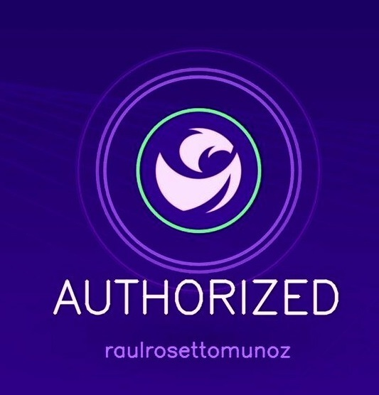
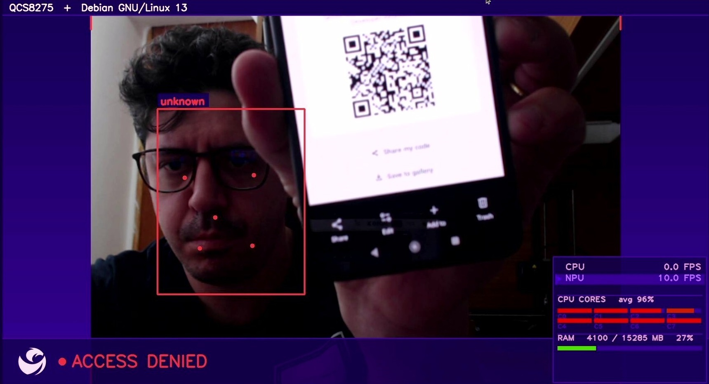
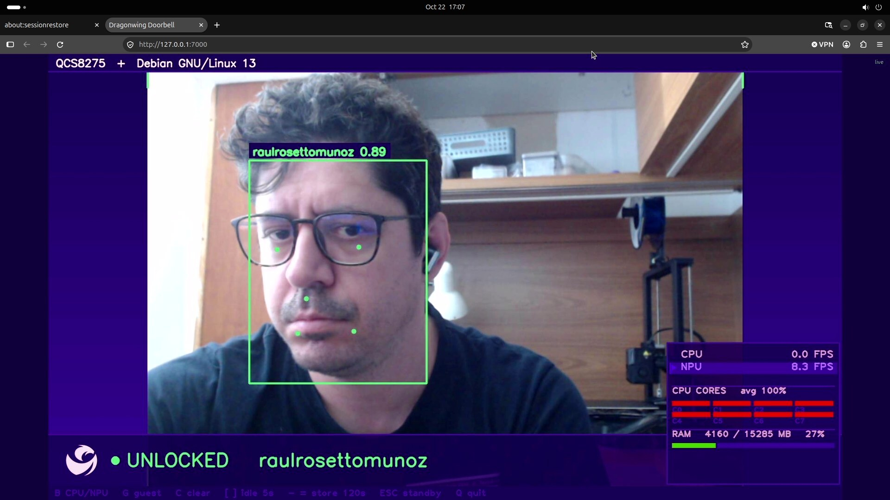

# From maker board to managed product: a face-recognition doorbell on Dragonwing

*Why you'd walk an edge-AI app from an Arduino board to Qualcomm Linux one deliberate
step at a time — and what the last mile to a real commercial product actually looks like.*

---

## The demo in one sentence

Point a USB webcam at a door. The app sits idle until someone appears, then runs
InsightFace detection **and** recognition on every face in the frame — green box for a known
person, red for a stranger — and lets anyone enroll themselves by showing a LinkedIn QR code,
holding their face inside an on-screen ring for ~30 frames. All of it runs on the **HTP v75 NPU**
(Neural Processing Unit) of a Qualcomm Dragonwing IQ-8275, at ~2 ms per detection instead of ~47 ms
on the CPU (Central Processing Unit).

That's the *what*. This post is about the *where* — because the same application runs in three
very different places, and the trip between them is the whole story.

---

## The journey, and why it has three stages

It is tempting to build an edge-AI product the way you build a cloud service: pick the final
platform, stand it up, and iterate in place. On embedded hardware that path punishes you. The final
platform — a Yocto-built Linux distribution, a locked-down boot chain, a camera behind an on-SoC
image signal processor — is the **slowest possible place to discover that your idea is wrong**. So
instead we moved the *same* application across three hosts, and at each step we **removed a layer of
guard-rails and added a layer of production-readiness**.

The application never forked. `doorbell.py` — the UI, the state machine, QR-triggered enrollment,
the recognition pipeline — is one body of code the whole way down. Across the three stages we swap
only the **two I/O (Input/Output) ends** (how inference is invoked, how the screen is drawn) and the
**host plumbing** underneath. That discipline is what makes the journey legible: when a face stops
getting a green box on QLI (Qualcomm Linux), you *know* it isn't the recognition logic, because that
logic is byte-for-byte the code that worked on Ubuntu.

### Stage 1 — Arduino VENTUNO Q + App Lab: prove the idea with zero friction

The on-ramp. An Arduino **VENTUNO Q** (QCS8300, same HTP v75) running under **Arduino App Lab** — a
guided application environment that hides the Linux entirely. No flashing, no model conversion by
hand, no display server to configure. A maker gets recognition on-screen in minutes.

The trade you accept for that speed: **you don't own the OS and you can't ship it.** App Lab is a
prototyping ecosystem, not a product substrate. The camera, the NPU runtime, the display — all of it
is mediated by App Lab's "bricks." We even wrote a **custom `arduino:face_recognition` brick** backed
by a companion NPU runner container, and the recognition it serves is the *exact same* InsightFace
`buffalo_sc` pipeline as production — but it lives inside App Lab's world, streamed into a webview.
Stage 1 answers one question — *does the idea work, and does it feel right?* — and answers it cheaply.

 The App Lab webview after a successful enrollment on the VENTUNO Q.

*(Stage 1 lives in its own repository,
[munoz0raul/dorbell-app-bricks](https://github.com/munoz0raul/dorbell-app-bricks), because it
follows Arduino's app-bricks-examples convention and drops straight into an App Lab apps directory.)*

### Stage 2 — IQ-8275 + Ubuntu: full control on production silicon

Now we move onto the **real production SoC (System on Chip)** — the QCS8275 — but under plain
**Ubuntu 24.04**, the most familiar, most forgiving Linux you can put on it. This is where the
application grows up. You have a shell, `apt`, a normal Python, a normal GNOME desktop, and a USB
webcam that enumerates predictably at `/dev/video0`. Iteration is fast because nothing is locked
down.

Two things get solved properly at this stage:

- **The NPU runs in-process.** The naïve way to use the HTP is to shell out to the `qnn-net-run` CLI
  (Command-Line Interface) per inference — but each spawn costs ~270–305 ms of FastRPC setup and
  model reload, forcing a batching scheme whose latency made the on-screen box visibly trail a moving
  face. We switched to loading the two compiled HTP context binaries **once** via `qai-appbuilder`
  (`QNNContext`) and calling `.Inference()` directly. Per-frame latency dropped from a ~0.5 s batch
  stall to **~5 ms**, the overlay tracks in real time, and the output is bit-for-bit identical to the
  CLI path. Press **B** at runtime and the whole pipeline swaps between CPU and NPU live — that
  side-by-side is the demo's thesis in one keystroke.

- **It gets containerized.** Bare metal is the fastest place to *iterate*, but it isn't what you
  *ship*. So Stage 2 ends by packaging the app as a Docker image that reaches the NPU through the
  official Dragonwing **CDI (Container Device Interface)**. The image stays driver-free —
  `qai-appbuilder` carries its own version-matched QNN (Qualcomm Neural Network) runtime and HTP v75
  skel, so the CDI only forwards the **kernel-coupled plumbing** that *can't* be pip-installed: the
  FastRPC device node, the DMA (Direct Memory Access) heaps, and the host's FastRPC userspace stubs.
  That container is the artifact that carries, unchanged, into Stage 3.

 Left: LinkedIn QR authorization on the IQ-8275 (Ubuntu). Right: recognized with NPU at 8.3 FPS.

### Stage 3 — IQ-8275 + QLI 2.1: managing your distribution

Finally we land on **Qualcomm Linux (QLI) 2.1**, the **Yocto-based distribution a commercial
Dragonwing product actually ships**. The container image from Stage 2 runs here *byte-for-byte
identical*. What changes is everything *beneath* it.

**But first — why move at all? Ubuntu works. Why not ship that?**

This is the question the whole stage exists to answer, and it's worth being blunt about, because
"Ubuntu runs the demo fine" is true and still the wrong thing to ship. Four reasons, and none of them
are about the application:

- **Ubuntu is someone else's image.** The Ubuntu-for-Dragonwing build is composed by Canonical and
  Qualcomm; you take it as given. You can `apt install` *on top*, but the base — the kernel, the init
  system, the hundreds of packages, the bundled DSP firmware — is not yours to strip, pin, or audit.
  You are renting an operating system, and a product you can't fully account for is a product you
  can't fully support.
- **`apt` gives you a different machine every time.** `apt install insightface onnxruntime` today and
  in six months resolve to different dependency trees. A fleet built across a year of manufacturing is
  a fleet of subtly *different* systems, and there is no single artifact that says "this is the OS we
  ship." Reproducibility isn't a nice-to-have here — it's the thing every later guarantee (a signed
  OTA, an SBOM, a CVE answer) is built on, and `apt` can't provide it.
- **The firmware you depend on moves on someone else's schedule.** The NPU only works when the host
  DSP firmware's QAIRT version matches the runtime in the container — we hit exactly this in Stage 2.
  On Ubuntu that firmware ships *inside the base image*, on Canonical's cadence; a routine base update
  can silently shift it out from under you and turn every doorbell in the field into a CPU-fallback
  that no longer tracks a face. You cannot build a product on a dependency you don't version.
- **A desktop distro is the wrong shape for an appliance.** Ubuntu carries a display manager, a
  package manager, dozens of services a doorbell will never use — more to boot, more to patch, more
  attack surface, bigger update payloads. And it is built to be *mutated in place* (`apt upgrade`),
  which is the opposite of what a field appliance needs: an immutable, atomically-swappable,
  rollback-able image.

**Yocto answers all four because the image is a *function of a manifest.*** You don't install QLI,
you *compile* it — from a manifest that pins the kernel, the BSP (Board Support Package), the DSP
firmware, the QAIRT version, and your app as one coherent, signed, reproducible release. Same
manifest in, same image out, byte-for-byte, forever. You include exactly what the doorbell needs and
nothing else. You own every version in the stack, so nothing shifts underneath you. And
appliance-shaping — read-only rootfs, A/B partitions, dm-verity, secure boot — integrates as
first-class layers instead of fragile bolt-ons. That is the whole trade: you give up Ubuntu's
*"it already works"* for a distribution you can *account for, reproduce, and defend.*

**And this is why the Ubuntu→QLI deltas are the point, not a detour.** QLI is not Ubuntu, and the
differences are not cosmetic — they're the moment the ownership becomes concrete. Each one is
something Ubuntu's general-purpose image *handled for you*, which sounds like a gift until you realize
it means you never controlled it:

- The display server is **Weston**, not GNOME. Its bundled Xwayland authorizes clients by **matching
  UID** over the X11 socket — there is no `.Xauthority` cookie file to mount. So the container runs as
  `--user 1000:1000` (the Weston UID), and UID-match *is* the authentication. *(On Ubuntu, GNOME
  invented and managed that cookie for you; now the display auth model is yours to choose.)*
- Libraries live in a **flat `/usr/lib`**, not Ubuntu's multiarch `/usr/lib/aarch64-linux-gnu`. The
  QLI CDI bind-maps each host library to the path the `ubuntu:24.04` container expects. *(The
  filesystem layout was never Ubuntu's promise to keep — you just never had to think about it.)*
- The on-SoC DSP (Digital Signal Processor) firmware ships a **specific QAIRT (Qualcomm AI Runtime)
  version** (2.50.0 on this build). A mismatched host QNN is rejected on-device and silently falls
  back to CPU — so the image pins a matching `qai-appbuilder` build, and the FastRPC DSP shell must be
  reachable at a *hardcoded* path the wrapper bind-mounts into place. *(This is the firmware-cadence
  problem from above, now solved the only durable way: you pin the firmware and the runtime together.)*
- Device nodes injected by the CDI arrive **gid 0**, which `--group-add` can't unlock — so the
  FastRPC and DMA-heap nodes are passed as plain `--device` instead, preserving their host group IDs.
- The USB webcam **enumerates high** (e.g. `/dev/video28`), behind ~28 on-SoC ISP (Image Signal
  Processor) and codec nodes — so the app probes the nodes actually present rather than a fixed range.

Every one of those is a thing that *does not exist as a problem* on Ubuntu — because Ubuntu made the
decision for you and hid it. On a product you *are* the one making the decision, and QLI is honest
about that from the first boot. A managed distribution is not a free lunch; it's the responsibility
you take on in exchange for a product you actually control. The reason to meet that responsibility
*here*, in Stage 3, and not on day one, is the whole thesis of this journey: by now the application is
already proven, so the only new thing you're learning is the platform.

---

## Why go in this direction at all?

Stage 3 made the case for Yocto over Ubuntu. Zoom out and there's a bigger pattern across all three
stages worth naming, because it's the real reason to walk them *in this order* rather than starting at
the end.

Each stage trades **convenience for ownership**, and it does so on a curve. App Lab owns almost
everything and asks almost nothing of you — you own only the application logic. Ubuntu hands back the
shell, the package manager, and in-process control of the NPU, but still owns the base image. QLI
hands back the entire stack and asks you to account for all of it. As you descend, the platform does
less *for* you and you control more *of* it — and critically, **the cost of being wrong goes up at
every step.** A wrong idea on App Lab costs an afternoon. A wrong architecture on QLI costs a Yocto
rebuild, a reflash, and a day.

So you spend your cheap mistakes where they're cheap. The three things that make a *demo* delightful
are precisely the three things that make a *product* impossible — and you want to have exhausted the
first before paying for the second:

1. **Someone else owns the OS.** App Lab, and to a lesser degree stock Ubuntu, decides what's
   installed, how the display works, when things update. Wonderful for proving an idea; disqualifying
   for a product that must own its boot chain, its update policy, and its security posture. You cannot
   ship on a platform whose rules you don't control — but you *can* prototype on one, fast.
2. **Nothing is reproducible by construction.** "It works on my board" is a sentence, not a build
   system. That's fine when the goal is to learn; it's fatal when the goal is to manufacture a
   thousand identical units. A product needs an image you can rebuild bit-for-bit from a manifest.
3. **There's no story for the field.** A demo lives on one board on one desk, where you are the
   update mechanism and the security model. A product lives on thousands of boards you will never
   touch again — so updates, telemetry, and security have to be designed in, not bolted on.

The journey answers all three *in the right order*: App Lab and Ubuntu are the cheapest possible way
to become **certain the application is right**, so that by the time you take on Yocto's cost of
ownership, the only thing you're still figuring out is the platform — never the product.

---

## What's next: the last mile to a commercial product

Everything above gets you a verified application running on the distribution you'll ship. It is **not
yet a product.** A product is the application *plus* the machinery that lets you build it
reproducibly, update it safely in the field, and trust it in a hostile environment. Four pieces close
that gap.

### 1. Managing your distribution — bake the app into a Yocto image

Today the app is a container you `docker build` and `docker run` on the board by hand. The product
version is a **Yocto image with the app already in it**, built from a manifest, flashable as a single
artifact. Concretely:

- **A custom Yocto layer (`meta-dorbell`)** carried on top of the QLI BSP (Board Support Package).
  It defines a recipe for the doorbell container (or, if you drop Docker, the app as a native
  `systemd` service), the matching `qai-appbuilder`/QAIRT version pinned to the on-device DSP
  firmware, and the NPU context binaries as a deployable artifact.
- **Boot-to-appliance.** A `systemd` unit (or a `docker compose` + restart policy) brings the
  doorbell up full-screen on the Weston display at boot, with a watchdog that restarts it on crash.
  The board stops being "a Linux box someone runs a script on" and becomes "a doorbell."
- **Read-only rootfs + a writable data partition.** The OS image is immutable; the only writable
  state is a small partition for configuration and the (encrypted — see §4) enrolled-face store. This
  is what makes OTA (Over-The-Air) updates atomic and rollback trivial: you never mutate the running
  system in place.
- **Pin everything.** Yocto's whole value is that the image is a *function of its manifest*. Pin the
  QLI release, the kernel, the DSP firmware, the QAIRT version, the app commit, and the model
  binaries. A given manifest must always produce the same image — that's the contract the rest of the
  machinery relies on.

The payoff: the "Ubuntu→QLI deltas" we solved by hand in Stage 3 (library paths, display auth,
firmware match, device gids) become **recipe metadata**, solved once in the layer and reproduced
automatically on every build.

### 2. CI/CD — for the Yocto image *and* the app, as two cadences

A product needs two pipelines running at two different speeds, because a Yocto build and an
application change have wildly different costs.

- **The app pipeline (fast, runs on every commit).** Lint, unit-test the state machine (the
  `render_states.py` headless renderer already dumps every UI screen to PNG for visual QA — that
  becomes a golden-image regression test), build the container image for `arm64`, and push it to a
  registry, tagged by commit. Hardware-in-the-loop: a board in the lab pulls the new image, runs a
  smoke test (camera opens, NPU initializes on `QNNExecutionProvider` not CPU fallback, a known face
  scores green), and reports pass/fail. This can run in minutes, many times a day.
- **The image pipeline (slow, runs on release).** A Yocto build is CPU-hours and tens of gigabytes of
  state, so it runs on a beefy builder with a warm `sstate-cache` and `DL_DIR`, on a schedule or a
  release tag — not every commit. It assembles `meta-dorbell` + the pinned QLI BSP into a signed,
  flashable image, publishes the image plus a manifest of exact versions, and archives the build
  artifacts for reproducibility and audit.
- **The seam between them.** The app pipeline produces a versioned container; the image pipeline
  *consumes a pinned version of that container*. A release is "image manifest X contains app version
  Y" — fully traceable, fully reproducible. The fast loop proves the app; the slow loop assembles the
  product.

Why split them? If you rebuild the whole Yocto image on every app commit, your feedback loop is
hours and nobody iterates. If you only ever ship app containers and never rebuild the base image, the
OS rots — unpatched kernel, drifting firmware. Two cadences keep both honest.

### 3. OTA updates — atomic, signed, and reversible

Thousands of doorbells in the field you will never touch again. Updates are not a feature, they are
the product's survival mechanism — and the one operation most likely to brick a fleet if done wrong.
The design that doesn't brick fleets:

- **A/B partitioning with atomic switch.** Two root filesystem slots. An update writes the *inactive*
  slot, verifies it, then flips a boot flag to switch slots on next reboot. The running system is
  never mutated. QLI/Yocto supports this directly through **RAUC** or **Mender** (or OSTree-style
  atomic trees); pick one and make the image layout match it from day one (this is why §1 insists on a
  read-only rootfs).
- **Automatic rollback on failed boot.** After switching slots, a boot-success watchdog must confirm
  the new image actually came up (display live, app healthy, NPU initialized). If it doesn't check in
  within N boots, the bootloader reverts to the known-good slot. A failed OTA costs a reboot, not a
  truck roll.
- **Signed update bundles.** Every bundle is signed by a key the device trusts (chained to the secure
  boot root of trust — §4). The device refuses to install an unsigned or tampered bundle. This is the
  line between "update" and "remote exploit."
- **Two independent update channels.** The fast one ships a new **app container** (small, frequent —
  a recognition tweak, a UI fix). The slow one ships a **full signed OS image** (kernel, firmware,
  QAIRT — infrequent, heavy). This mirrors the two CI cadences in §2 and keeps most updates cheap
  while still having a path to patch the platform.
- **Staged rollout + telemetry.** Ship to 1% of the fleet, watch health metrics (crash rate, NPU
  fallback rate, boot success), then widen. Never flip 100% of devices at once.

### 4. Security — the implementations a shipped product requires

A demo reads no secrets and trusts its whole environment. A product in the field is a hostile-world
device holding **biometric data**. Security stops being optional and splits across the whole stack:

**Boot & platform integrity**
- **Secure boot** — a hardware root of trust verifies each stage of the boot chain (bootloader →
  kernel → rootfs), so the device only runs images signed by you. Without this, every other control
  is bypassable by flashing a hostile image.
- **dm-verity on the read-only rootfs** — the kernel verifies the integrity of every rootfs block
  against a signed hash tree at runtime, so on-disk tampering is detected, not just at-boot.
- **Signed OTA bundles chained to the same root of trust** (§3) — the only way new code reaches the
  device is through a signature the hardware trusts.

**Data at rest — this app holds faces**
- The enrolled-face store is **in-memory with a 2-minute TTL (Time To Live)** today — deliberately,
  nothing touches disk, which is already a strong privacy posture for a demo. A product that persists
  enrollments must **encrypt that partition** (LUKS or fscrypt), with the key sealed to the device's
  **TEE (Trusted Execution Environment)**/TPM (Trusted Platform Module) so a stolen flash chip yields
  nothing.
- **Store embeddings, never raw images.** The 512-dimension ArcFace embedding is not reversible to a
  photograph; the raw frames should never be written. This is a privacy-by-design choice that also
  shrinks the blast radius of any breach.
- **Biometric data is regulated** (GDPR/BIPA and kin). Retention limits, a consent flow for
  enrollment, and a defensible deletion path are product requirements, not nice-to-haves. The QR
  self-enrollment flow is a natural place to anchor explicit consent.

**Runtime & network**
- **Least privilege for the NPU.** The Stage 3 work already moved in this direction — device nodes
  passed individually with their real group IDs rather than `--privileged`. A product should keep that
  discipline: no blanket privilege, a minimal set of forwarded nodes, a non-root container user (the
  Weston UID), seccomp/AppArmor profiles.
- **Secrets management.** The one secret today (the AI Hub token) is read from an environment variable
  and never committed — the right instinct. A product extends that: provisioning credentials,
  device-identity keys, and the OTA signing trust anchor live in the TEE or a secure element, never in
  the image.
- **Network minimalism.** The appliance should make only the outbound connections it needs (OTA check,
  telemetry) over mutually-authenticated TLS, with no inbound services exposed. Every open port is
  attack surface.

**Supply chain**
- **Pin and verify dependencies** (Yocto already forces version pinning; extend it to checksum
  verification and a vendored mirror so a compromised or vanished upstream can't alter a build — we
  already hit a version of this when PyPI pulled a `qai-appbuilder` release out from under us).
- **Generate an SBOM (Software Bill of Materials)** per image — Yocto can emit one — so you can answer
  "are we affected by CVE-X?" across a shipped fleet in minutes, not weeks.

None of these is exotic; together they are the difference between a thing that runs and a thing you
can sell, support, and defend.

---

## The throughline

One application. Three hosts. At each step you give up a convenience and take on a capability: App
Lab's zero-setup for Ubuntu's full control; Ubuntu's familiarity for QLI's ownership. The last mile —
a managed Yocto image, two-cadence CI/CD (Continuous Integration / Continuous Delivery), atomic
signed OTA, and security rooted in hardware — is what turns "it runs on the board on my desk" into
"it runs on ten thousand doors, updates itself safely, and protects the faces it sees."

The reason to walk it in stages is the same reason you don't start by owning the hardest version of
the problem: **by the time you're solving Yocto CDIs and OTA rollback, you already know — with
certainty — that the thing you're shipping is worth shipping.**

---

*Hardware: Qualcomm Dragonwing IQ-8275 (QCS8275, HTP v75). Qualcomm, Dragonwing, and Snapdragon are
trademarks of Qualcomm Incorporated. This is a technical demonstration, not an affiliated product.*
